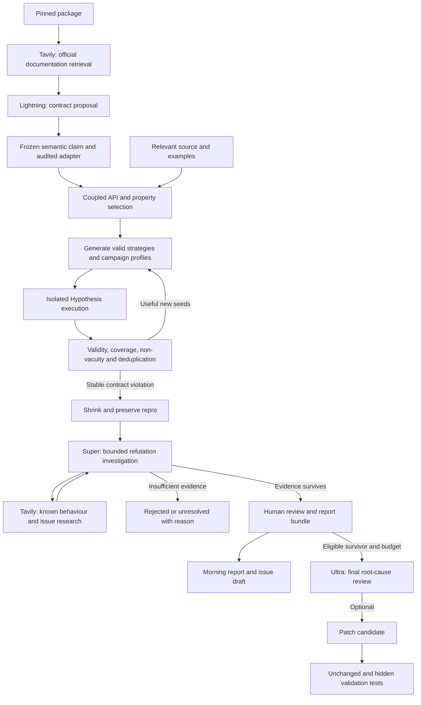

# Nightshift: research-backed improvements and experiment plan

**Research date:** October 18, 2026  
**Revision:** 1.1 — incorporates review feedback after checking the proposed technical changes  
**Project:** An overnight bug hunter for open-source Python libraries  
**Team constraints:** Three teammates; $0 cash expenditure; only credits actually awarded  
**Purpose:** Identify methods that improve discovery quality, credibility, and efficiency enough to justify implementation before the hackathon deadline.

## 1. Recommendation

Build Nightshift around **documented contracts, structured input search, and active attempts to disprove each suspected bug**.

The strongest product story is:

> Nightshift searches for violations of documented behaviour, then builds a small, reproducible case explaining why each surviving finding deserves a maintainer's attention.

The main improvement over the original proposal is separating two questions:

1. **What behaviour is required?** Derive this from version-matched documentation, explicit specifications, and carefully interpreted tests.
2. **Which inputs exercise difficult behaviour?** Use implementation details, valid examples, execution feedback, and structured search.

Source code is valuable for the second question. Its current output cannot automatically answer the first when the purpose is to find existing bugs.

Keep the overnight workflow, NVIDIA models, Nebius execution, cost accounting, and polished morning report. Make the technical centrepiece the quality of the evidence rather than the number of agents or model tiers.

The hackathon implementation makes Tavily's documentation and known-behaviour research visible, assigns concrete Nemotron roles, and uses a compact PBT-Bench comparison. Scientific claims still follow the evidence: adding sponsor tools or three model names does not establish accuracy, novelty, or publishability.

“11/10” is an ambition, not an established score. The proposed improvements below are research-informed engineering hypotheses. Their effect on Nightshift must be measured; no combination of papers guarantees previously unknown bugs or a hackathon prize.

## 2. Research scope and strength of evidence

The reading map at the end contains **35 papers**, spanning property-based testing, fuzzing, test oracles, metamorphic testing, repair validation, routing, and agent design. For the 22 entries marked **M**, relevant method and/or evaluation sections were inspected in primary full text. For the 13 entries marked **S**, screening was limited to a primary abstract, author overview, or short paper summary. This is a focused review, not an exhaustive systematic literature review or a claim that every paper was read cover to cover.

Prioritize papers that change a specific implementation decision. Separate these evidence levels:

- **Direct:** Python testing, bug discovery, oracle construction, or difference-exposing tests close to Nightshift's task.
- **Transfer:** Results from compilers, Java, deep-learning libraries, network protocols, or general model routing. The mechanism may transfer; reported gains do not transfer automatically.
- **Design inspiration:** General agent/refinement papers. Useful for organizing work, weaker evidence for discovering real bugs.

The papers use different targets, models, compute budgets, and definitions of success. Their percentages are not comparable leaderboard scores. Publication titles can change across versions; the reading map uses the checked primary page and identifies notable title changes.

## 3. What the original proposal gets right—and where research changes it

[Agentic Property-Based Testing](https://arxiv.org/abs/2510.09907) is a direct foundation: it generates and executes properties, investigates failures, and produces reports. Its manually reviewed results distinguish valid bugs from findings worth reporting: 56% and 32%, respectively, with higher precision among top-ranked reports. This supports the approach while making report usefulness a first-class objective. Its workflow is already prior art; Nightshift should cite and build on it.

[WhiteFox](https://arxiv.org/abs/2310.15991) already separates an analysis model from a generation model and uses Thompson sampling to select helpful examples. Therefore, “large model plus cheap workers plus a bandit” is not a defensible stand-alone novelty claim. Adapting that pattern to trustworthy Python-library bug discovery remains a useful engineering direction.

The largest opportunities are:

| Original component | Research-informed improvement | Reason |
|---|---|---|
| One model reads the repository and proposes properties | Independently derive a versioned behavioural contract; let a separate generator inspect source for reachability | Reduce the chance of copying faulty behaviour into expected results |
| Hundreds of separately generated tests | Generate a few strong input strategies and execute many structured examples | Spend model tokens on semantic work, not every input |
| Single-function properties | Search relationships between coupled APIs and state transitions | Reach bugs hidden in composition |
| Bigger model judges a failure | Bounded investigator runs experiments that challenge the bug hypothesis | Obtain evidence beyond a persuasive explanation |
| Model-and-thinking-budget bandit | Start with a measured escalation policy; optionally learn seed/strategy allocation later | Better feedback availability and lower cold-start complexity |
| Patch passes the discovered test | Preserve the contract and add fresh tests hidden from the patch generator | Reduce overfitting to one counterexample |
| Dollar cost per reported bug | Cost and human review time per unique validated finding | Avoid rewarding duplicated or low-value reports |

## 4. Upgrade A: establish the contract before testing the implementation

### Research basis

[Measuring the Influence of Incorrect Code on Test Generation](https://arxiv.org/abs/2409.09464) studies how faulty source can mislead test generation. [Design choices made by LLM-based test generators prevent them from finding bugs](https://arxiv.org/abs/2412.14137) shows the danger of workflows that reject or revise failing tests to fit existing behaviour. [Doc2OracLL](https://doi.org/10.1145/3729354) examines documentation as an oracle-generation source; its Java setting and fine-tuning setup differ from this project.

### Nightshift adaptation

Create a **contract record** before generating a test. For the first contract pass, supply version-matched documentation, public signatures, declared types, and authoritative examples. Exclude the target implementation body and observed outputs. Resolve any ambiguity explicitly instead of filling it with a model guess.

Each record contains:

```yaml
contract_id: example.contract.01
package_revision: immutable_commit_or_distribution_hash
api: package.module.function
claim: A concise statement of required behaviour
evidence:
  source: versioned_documentation_path_or_url
  excerpt: short_exact_supporting_text
  content_hash: sha256_of_retrieved_material
input_domain:
  accepted_types: explicit_types
  preconditions: explicit_predicates
  exclusions: unsupported_or_unspecified_cases
semantic_relation:
  claim: immutable_behavioural_invariant
  assertion_template_hash: hash_of_approved_predicate_and_comparator
  equivalence: exact_or_documented_semantic_comparison
adapter:
  artifact: separate_versioned_harness_adapter
  permitted_projection: only_the_documented_return_component
  audited_against_contract_version: required_before_campaign
status: explicit | inferred | ambiguous
```

Then give a different generation context the frozen contract and relevant source. It may change generators, setup, and reachability tactics. It cannot silently weaken the claim or change the assertion to match the current output.

Separate the **immutable semantic claim** from an **editable harness adapter**. The adapter may construct required configuration objects, invoke APIs, and select a documented return component. For example, if an encoder returns `(payload, metadata)`, selecting the documented payload can be valid plumbing; assuming metadata is irrelevant without evidence cannot be accepted automatically.

Keep the assertion predicate, comparator, and preconditions in the controller-owned test wrapper. The adapter supplies inputs and observable results. It must not replace expected values with observed outputs, swallow assertion failures, skip the check, or introduce undocumented normalization. Record required API calls so an adapter that simply returns the input cannot masquerade as a round trip.

Audit adapter changes using deterministic checks, source-backed call examples, and a review context containing the frozen claim and adapter but excluding the target implementation body. Use human review for ambiguous mappings. A fixed “50-token check” cannot establish semantic equivalence; allocate enough output for a reasoned accept/reject result and retain uncertainty. If setup reveals that the claim itself needs revision, use the explicit contract-version process below.

### Tavily as the external evidence layer

Make two runtime uses part of the supported live workflow [T5–T7]:

1. **Contract evidence:** use Tavily Search to locate official versioned documentation, then Extract on a bounded URL list. Prefer an explicit version URL or repository revision. Use a tightly limited Crawl only when navigation discovery is necessary.
2. **Known-behaviour investigation:** search the package's issues, release notes, and relevant external discussions for the exact symptom and API. Inspect the underlying source before classifying a match.

Store URL, retrieval time, claimed document version, source authority, exact supporting excerpt, full extraction-result hash, and the hash of the canonical text actually supplied to the contract builder. A hash identifies retrieved material; it does not prove that a page matches the tested revision. Extraction is also not necessarily a byte-identical copy of the original web page.

Treat RFCs and PEPs as binding only when the library promises the relevant compliance and options. A URL parser is not automatically wrong because it differs from every provision of RFC 3986. Official docs outrank a forum workaround; discussion provides an investigative lead rather than authority by itself.

Inspect extraction failures even when the HTTP request succeeds. Do not substitute an empty result, an unversioned latest page, or a search snippet for verified evidence. External text is data and cannot change tool permissions or the contract policy.

In the product, show “Documentation evidence” and “Known behaviour checks” with source links, relevant excerpts, and Tavily usage. Keep raw queries and detailed receipts in the evidence view. If nothing relevant is found, report the search scope and uncertainty; never label the result “definitely new.”

For controlled benchmark runs, use the benchmark's frozen, agent-approved docs and deny external issue/fix lookup. This prevents Tavily from leaking the benchmark answer. Demonstrate live Tavily retrieval in a separate upstream campaign. Label cached and live retrieval accurately.

If new evidence invalidates the contract, create a new version with a reason and retain the old result. This is legitimate correction, not a forbidden action. The constraint is traceability: the system cannot make a failure disappear by changing its definition without recording why.

**Example:** `decode(encode(x)) == x` is unsafe if the domain includes unsupported types or a representation deliberately normalizes information. Define the accepted values and the appropriate equivalence relation first. A serialization round trip over JSON-compatible values is different from a round trip over arbitrary Python objects.

### Test the adaptation

Compare joint source-and-oracle generation with contract-first generation on identical tasks and budgets. Independently review contract correctness, input validity, false alarms, and valid findings. Measure reachability too: hiding source from the oracle may improve precision while making some contracts harder to infer.

**Priority:** P0. Approximately one day for the record format, prompt separation, and immutable versions, after the execution skeleton exists.

**Limit:** Documentation can be incomplete, stale, or wrong. Separate model contexts reduce one source of contamination; they do not create independent truth or calibrated confidence.

## 5. Upgrade B: discover relations between APIs

### Research basis

[MR-Scout](https://arxiv.org/abs/2304.07548) extracts and generalizes metamorphic relations encoded in existing tests. [MR-Coupler](https://arxiv.org/abs/2604.10126) uses functional coupling to select promising method pairs, then generates and validates metamorphic tests. Its coupling features include signature commonality, call relationships, and shared state. These are predominantly Java/object-oriented results, so a lightweight Python adaptation is a new experiment, not a reproduction.

### Nightshift adaptation

Build a small API relationship index with lightweight heuristics rather than a whole-program static analyzer. Combine public signatures, AST scanning, and existing tests. Rank candidate pairs using:

- Complementary names and compatible types, such as parse/format or encode/decode.
- Shared data types and documented default parameters.
- Direct calls or shared helper calls.
- Methods that read and write the same state.
- Existing tests that compare related executions.

For P0, scan test functions for pairs of API calls and nearby relational assertions, normalize simple imports/re-exports when resolvable, and inspect names/defaults through signatures. Attribute load/store scans inside one class are optional hints. Use `inspect.signature()` and imports only inside the prepared package sandbox: importing arbitrary Python can execute code. Do not import target packages into the application controller.

Test co-occurrence is a cheap candidate-generation signal, not evidence of a “95% accurate” coupling detector. Helpers may call unrelated APIs, aliases can defeat simple resolution, and many calls in one test are setup. Keep provenance, cap candidates, and validate each proposed relationship against documentation. Measure precision and runtime on the chosen packages before reporting either.

These features propose where to look. They do not prove that an invariant holds. Every proposed relation still needs a contract and preconditions.

Start with four relation families:

| Family | Candidate relation | Necessary qualification |
|---|---|---|
| Round trip | Decode an encoded value | Restrict to supported values and documented normalization |
| Equivalent interfaces | Convenience call agrees with general call using documented defaults | Verify exact default semantics and side effects |
| Composition | Chunked or composed operation agrees with a single operation | Only where ordering, buffering, and boundary semantics permit |
| State agreement | A documented update is observable through a corresponding read | Model key equality, expiry, eviction, and state preconditions |

Do not generate an all-pairs quadratic workload. Select a small number of high-evidence pairs per package. In Python, dynamic dispatch and missing annotations make static coupling approximate; record that limitation.

### Test the adaptation

Within each package, compare a fixed number of single-function properties with the same budget spent on coupled relations. Measure valid unique bug families and review burden. If relation mining produces mostly unsupported assumptions, keep human-authored relation templates and automate only candidate selection.

**Priority:** P0 for a handful of templates and selected pairs; P1 for broad automatic mining. One day for the narrow version.

## 6. Upgrade C: let the model design a search, then let the test engine work

### Research basis

[Hypothesis](https://joss.theoj.org/papers/10.21105/joss.01891) supplies property-based generation and reduction infrastructure. [Targeted Property-Based Testing](https://proper-testing.github.io/papers/issta2017.pdf) guides search with informative utility values. [PBT-Bench](https://arxiv.org/abs/2605.15229) directly examines documentation-derived invariants and input strategies concentrated in difficult trigger regions. Its injected defects make controlled evaluation possible; they are not evidence that Nightshift will find unknown upstream bugs.

### Nightshift adaptation

Have the model return a reusable Hypothesis strategy, setup, relation, and bounded search hints. Avoid asking a model to invent thousands of independent concrete inputs.

Prefer constructive valid generators over broad inputs with excessive rejection. For a version-string parser, generate structured valid version components and edge cases within that grammar instead of arbitrary text that is rejected immediately.

Measure:

- Fraction of generated examples satisfying preconditions.
- Whether assertions execute or return early.
- Whether the target API and relevant branch are reached.
- Relevant shape/feature diversity.
- Execution time and memory limits.

Treat syntax errors, installation problems, failed setup, invalid generated inputs, and actual contract violations as separate outcomes. Never count them all as bugs.

Use targeted search only when there is a meaningful, bounded utility: nesting depth, collision count, parser state reached, or distance to a documented boundary. Do not maximize raw input size or latency without justification; that can optimize resource exhaustion instead of useful semantic exploration. Hypothesis's documented `target()` requires finite observations [T1].

### Fast search and separate coverage diagnostics

Run ordinary search with lightweight counters first. A proposed starting profile uses `max_examples=200`, with explicit process-level time and memory caps. This count is a tuning choice, not a promise of 200 function calls. Hypothesis can stop early, reject draws, reuse examples, and perform additional reduction work [T8].

Record generated cases entering the body, cases satisfying explicit preconditions, cases reaching at least one frozen assertion, and observed contract failures. Use generation-phase counts when available; keep replay/shrink counts separate. If the chosen collector cannot separate phases reliably, label the metric accordingly rather than presenting a false precise rate.

Define assertion reach rate using **observed generated body entries** as the denominator, not configured `max_examples`. Track rejected draws separately through available runner statistics. A real contract failure found on the first case is meaningful, even if the run never approaches its example limit.

A low reach rate can trigger one bounded strategy/adapter repair after a minimum observed sample and only when no valid failure has already been found. A proposed 20% threshold is an initial warning to calibrate on development tasks, not a research-established universal gate. Require the repair to preserve the frozen claim.

Collect branch coverage in a separate diagnostic batch after initial search or a plateau. Preserve its seed/profile and label its timing separately. Coverage tracing may still instrument each execution within that batch; the saving comes from restricting tracing to selected batches, not from claiming instrumentation is free. Measure actual overhead on the chosen packages rather than assuming a universal 5–10× slowdown.

Use explicit Hypothesis settings in both modes. If per-case deadlines are disabled to avoid instrumentation-induced timing failures, retain hard worker time/memory caps and classify timeouts separately. Performance-bug detection requires a dedicated timing protocol and is outside this semantic-testing profile.

### Test the adaptation

Compare default broad strategies against constructive strategies with the same runtime budget. Add targeting as a separate ablation. Report valid-input rate, time to first validated finding, and total cost including generator repair.

**Priority:** P0 for constructive generators and non-vacuity checks; P1 for custom numeric targeting. Half a day to one day beyond basic test execution.

## 7. Upgrade D: escape plateaus with feedback and deliberately different campaigns

### Research basis

[CodaMosa](https://sidsen.azurewebsites.net/papers/codamosa-icse23.pdf) combines search-based testing with model-generated seeds to overcome coverage plateaus. [CoverUp](https://arxiv.org/abs/2403.16218) uses coverage and code context to guide generation. [Fuzz4All](https://arxiv.org/abs/2308.04748) uses focused prompting, examples, and varied generation strategies. [Swarm Testing](https://agroce.github.io/issta12.pdf) deliberately varies which features appear in individual campaigns. These mechanisms suggest complementary search tactics; their coverage results do not establish Nightshift's bug precision.

### Nightshift adaptation

Run several small, valid campaigns with different emphases rather than many identical model workers. Example text-processing campaigns:

- ASCII boundary cases.
- Unicode combining sequences.
- Supplementary-plane characters, if supported by the contract.
- Empty/minimal values and escaping interactions.

For stateful objects, vary permitted operation subsets and sequence lengths while preserving valid state transitions. A sequence of many inserts followed by reads may explore states that alternating insert/delete never reaches.

Persist a small corpus of seeds that reach new relevant behaviour. After a fixed period without progress, show the generator the uncovered branch, valid seed, and compact trace. Ask for a changed strategy, not another copy of the same test.

Keep coverage in the search loop, but never make “all generated tests pass” the discovery objective. A failing contract test is a candidate to investigate.

### Test the adaptation

Compare one broad campaign with several narrower campaigns under equal aggregate CPU, wall-time, and inference limits. Record duplicate seeds and duplicate bug families. More executions alone do not demonstrate a better method.

**Priority:** P0 for fixed diverse campaign profiles and seed reuse; P1 for automatic plateau detection. Approximately half a day for profiles on the first supported family.

## 8. Upgrade E: make triage an investigation that can reject its own hypothesis

### Research basis

[LogicHunter](https://arxiv.org/abs/2607.06195) investigates suspicious behaviour using documentation, source inspection, and targeted execution rather than relying only on passive classification. Its evaluated targets and models differ from Nightshift's. It also uses repeated oracle sessions, trading additional cost and conservative reporting for precision. [Mokav](https://arxiv.org/abs/2406.10375) uses execution feedback to find observable differences between programs; a difference still needs semantic interpretation.

### Nightshift adaptation

Give a bounded investigator a **refutation checklist** and a small tool set. Its job is to find evidence that the property, environment, or interpretation is wrong before endorsing a report.

| Alternative explanation | Required check |
|---|---|
| Input violates the public contract | Evaluate the explicit input predicate and inspect the cited documentation |
| Failure is intentional normalization | Check the documented equivalence relation and nearby examples |
| A version mismatch explains the result | Verify installed distribution, revision, dependency versions, and doc version |
| Setup or environment is broken | Run a known-valid control in the same environment |
| Failure is flaky or state-contaminated | Rerun the exact minimized repro in fresh processes |
| Reference comparison is semantically incompatible | Check options, supported domain, and shared implementation dependencies |
| The test itself is faulty | Inspect assertion path, helper code, and whether the required API was reached |

An assertion failure often occurs in the test file, and silent semantic bugs may produce no library exception. Do not import an exception-filtering heuristic as a universal rule that discards these cases.

Allow a proposed initial limit of three investigative experiments per candidate, plus fresh-process replay. This is a budget policy to tune, not a research-derived optimum. Each experiment must record the question, command, result, and effect on the verdict. If evidence is insufficient, return **unresolved** instead of forcing a yes/no answer.

### Structured investigator tools

Expose controller-validated operations, rather than a general shell:

| Tool | Input | Result and guard |
|---|---|---|
| `run_control_input` | Registered adapter ID and approved input fixture ID | Runs a known-valid case in the pinned sandbox and returns structured output |
| `inspect_doc_and_source` | Allowlisted package symbol and bounded line range | Returns separate versioned documentation/source excerpts; reads cannot change the contract |
| `check_boundary_neighborhood` | Candidate ID and an approved perturbation profile | Executes a capped, domain-valid neighbourhood and preserves the original failure |
| `search_known_issues_tavily` | Candidate ID plus bounded search terms | Searches approved domains and returns cited known-behaviour leads and usage |

Avoid `python_expr` as the normal tool argument: that is executable code despite a structured wrapper. If a new custom experiment is necessary, use the existing adapter review process and isolated execution, not an unrestricted expression evaluator.

The starting limits are three runtime experiments, six total tool invocations, and two Tavily Search requests per candidate; ordinary fresh-process repro is a separately capped deterministic runner operation. Tools use typed schemas, bounded outputs, timeouts, and predefined environment access. These limits are adjustable policy, not optimal values from a paper.

Invalid requests return structured validation errors and still count against the total call cap. Permit a bounded correction while runtime slots count only actual submitted experiments. Structured tools reduce syntax errors; they cannot promise zero errors. An incomplete investigation remains unresolved.

Known-behaviour outcomes distinguish exact existing issue, documented intended behaviour, plausible related issue, no relevant match found, and lookup unavailable. Verify version applicability. A “won't fix” decision does not necessarily mean the reported behaviour satisfies the contract; it may be a valid known limitation.

Use distinct states: raw anomaly, reproducible candidate, AI-reviewed candidate, human-validated finding, maintainer-confirmed finding. Never label repeated agreement by the same model as independent proof. Do not copy a four-session consensus scheme by default under the team's credit limit.

### Test the adaptation

Construct a frozen candidate set containing real bugs, invalid-input failures, documented differences, test mistakes, and environment failures. Compare a one-shot judge with the bounded investigator. Measure precision, recall, cost, and human minutes per accepted finding. Track conservative rejection of real bugs as well as false positives.

**Priority:** P0. Approximately one day for the checklist, bounded tools, and recorded experiment results.

## 9. Upgrade F: test one stateful API against a small explicit model

### Research basis

[Feedback-directed Random Test Generation](https://people.csail.mit.edu/cpacheco/publications/feedback-random.pdf) constructs and reuses useful operation sequences. [ChatAFL](https://www.ndss-symposium.org/wp-content/uploads/2024-556-paper.pdf) uses protocol knowledge to improve structured messages and state exploration. Their settings differ from Python library testing, but they motivate valid sequences rather than isolated calls. Hypothesis supplies a stateful testing interface [T2].

### Nightshift adaptation

After the first pure-function workflow works, add one supported stateful target: for example, a documented bounded cache. Define a small reference model with explicit semantics. Generate sequences such as insert, overwrite, read, delete, and clear; include eviction only if the model faithfully represents the documented policy.

After each valid operation, compare observable state with the model. Use generated keys/values from a restricted supported domain. Do not add nondeterministic clocks, concurrency, or real services to the initial target.

Track preconditions so “delete absent key” is tested according to its documented result rather than arbitrarily treated as a bug. Shrink a failing operation sequence while preserving the same discrepancy.

### Test the adaptation

Compare single-call tests against sequences under the same runtime cap. Report the additional defects found and the manual work required to construct the reference model. Model construction is part of the cost, even if it uses no inference credits.

**Priority:** P1. One carefully chosen target can be feasible; automatic state-model synthesis for arbitrary libraries is outside this build.

## 10. Upgrade G: turn a failure into a small evidence bundle

### Research basis

[Simplifying and Isolating Failure-Inducing Input](https://homes.cs.washington.edu/~mernst/teaching/6.893/readings/zeller-tse.pdf) provides delta debugging and the useful distinction between a global minimum and a 1-minimal failing case. Its guarantees depend on the test predicate and reduction model. Hypothesis provides its own shrinking infrastructure; Nightshift should use it before implementing a new reducer.

### Nightshift adaptation

Reduce the input with Hypothesis. If the repro includes unnecessary setup or an operation sequence, apply a second bounded, syntax-aware reduction pass. Preserve all of the following:

1. Input remains within the claimed contract.
2. The same semantic violation still occurs.
3. The package and environment remain pinned.
4. A failure does not become merely an import error or different exception.

Stop at the reduction budget and describe the result as a **reduced repro**, unless the relevant minimality condition was actually checked. Do not claim a globally smallest input.

Create one downloadable bundle per candidate:

- Package/revision and dependency manifest.
- Contract with source evidence, preconditions, and comparison semantics.
- Small repro script and property test.
- Actual output, expected relation, and failure classification.
- Known-valid nearby control.
- Exact repro results from three fresh processes, with environment parameters recorded.
- Optional reference/fixed-version comparison and its limitations.
- Investigator checks, uncertainty, and human review state.
- A deterministic provenance manifest, source receipts, Tavily request IDs/credit usage, inference usage, execution time, and spend to date.

Three successful replays are a practical reproducibility check, not a statistical guarantee. Vary relevant nondeterminism, such as hash seeds, when useful. Time-dependent and flaky failures need a separate analysis.

For differential testing, label a result **disagreement** until the contract or review identifies incorrect behaviour. Two implementations may share a bug; two versions may intentionally differ; a reference can also be wrong.

**Priority:** P0. Use an existing shrinker and a simple manifest before adding elaborate root-cause tooling.

## 11. Upgrade H: use mutation testing to test the tests

### Research basis

[MuTAP](https://arxiv.org/abs/2308.16557) uses surviving mutants to guide test improvement. Its method also replaces some expected outputs with the program-under-test's outputs. That step is appropriate to its particular regression/mutation workflow assumptions but would risk accepting existing bugs in Nightshift. Borrow the mutant-survival feedback, not an automatic rule that observed output defines correctness.

### Nightshift adaptation

On a small known-correct reference or reviewed function, create a few reviewed semantic mutants: wrong boundary, dropped character, incorrect normalization, or broken state update. Check whether a proposed property can detect relevant faults while passing the clean control.

A test that always raises, rejects all input, or never reaches its assertion must fail this quality check. Validate the input domain independently. Exclude non-compiling mutants and record potentially equivalent mutants instead of treating every survivor as test failure.

Mutation testing serves two roles:

- **Development:** expose weak or vacuous property templates before an expensive discovery campaign.
- **Evaluation:** measure sensitivity to particular injected fault classes separately from real-bug discovery.

Do not run a full mutation campaign on every package. Do not let mutation score replace report precision or maintainer usefulness. Do not select every final evaluation fault because it happens to be killed by Nightshift's current templates.

**Priority:** P1 for a small template-quality check; P0 for simpler non-vacuity checks that do not require mutants. Start with two or three properties and several reviewed mutations, not an entire new subsystem.

## 12. Upgrade I: spend expensive inference where it can change an outcome

### Research basis

[RouteLLM](https://arxiv.org/abs/2406.18665) learns strong/weak model routing from preference data; its demonstrated routing task is not a ready-trained bug-discovery policy. WhiteFox offers a closer example of selecting productive generation examples using observed feedback. Neither establishes that an online model-and-thinking-budget bandit will learn effectively from Nightshift's small number of confirmed bugs.

### Nightshift adaptation

Make the three Nemotron roles explicit. The official cookbook lists these API identifiers [T9]; verify them against the team's actual account and configured region before running:

| Tier | Configured model | Product responsibility | Intended reasoning profile |
|---|---|---|---|
| 1 | `nvidia/Nemotron-3_5-Lightning` | Contract proposals, constructive strategies, diverse profiles, bounded setup repair | Off/low where supported and validated |
| 2 | `nvidia/nemotron-3-super-120b-a12b` | Bounded refutation investigation and difficult adapter/contract review | Moderate effort where supported and validated |
| 3 | `nvidia/Nemotron-3-Ultra-550b-a55b` | Final root-cause review for selected survivors and optional patch proposal | Higher effort within an explicit cap, where supported |

These are role assignments and requested profiles, not verified parameter values. “Medium” or “high” must not be sent as an invented provider option. Probe supported controls, confirm that the client forwards them, and log the effective request. A rejected or ignored control is not a successful reasoning-budget experiment. A completion-length cap is not automatically a separate thinking-token budget.

Implement Lightning and Super in the core path. Configure Ultra as a capped survivor stage; its unavailability must not prevent an otherwise valid report. Plan an actual Ultra root-cause review on one validated survivor when access and credits permit, and show that receipt if performed. If no eligible survivor exists, do not call Ultra merely to populate a three-model chart.

The evidence bundle itself is assembled deterministically from persisted results. Ultra can add a cited root-cause explanation but cannot invent missing experiments, change a contract, or upgrade human/maintainer review status. Patch validation remains an execution gate regardless of the model that proposes the patch.

Give each stage a measured success/cost target. A small model taking many repair turns can cost more per successful task than a stronger model. Record actual model names, region/base URL, requested controls, usage, and role outcomes so the submission demonstrates meaningful use of the sponsor stack.

Log the reason for every escalation. Distinguish **more inference might help** from **required information is absent**. Do not pay a bigger model to invent missing specifications.

For an optional adaptive scheduler, begin with only a few strategy families. Allocate an initial equal exploration budget, then use directly measured useful progress—valid execution reaching new relevant behaviour—as an explicitly named proxy. Confirmed unique bugs remain the final outcome. Do not claim that a proxy-optimized scheduler maximizes true bug yield.

Defer a learned router until there is enough labelled development data and a held-out comparison. Use verified reasoning controls when they help a measured stage outcome. The mandatory deadline evaluation is the two-system comparison in Section 16; a separate cheap-only/strong-only routing study is optional and must not displace live findings or product work.

**Priority:** P0 for cost accounting and explicit escalation; P1 for seed scheduling; later research for learned contextual routing.

## 13. Upgrade J: challenge patches with tests they did not see

### Research basis

[Is the Cure Worse Than the Disease?](https://people.cs.umass.edu/~brun/pubs/pubs/Smith15fse.pdf) studies repair overfitting. The later [Investigating Test Overfitting on SWE-bench](https://arxiv.org/abs/2511.16858), previously titled “Is the Cure Still Worse Than the Disease?”, shows that passing generated reproduction tests can still fail hidden tests and that additional refinement may break other functionality. Test-passing patches are therefore candidates, not correctness proofs.

### Nightshift adaptation

Freeze the contract and discovery test before a patch is generated. Give the patcher the minimal repro, contract, and relevant source. Keep a set of additional generated examples/seeds and independently reviewed boundary tests hidden from it.

Validate a candidate patch against:

1. The unchanged discovery test.
2. The available unchanged project test suite, with the exact scope reported.
3. Fresh property inputs and hidden boundary cases.
4. Nearby documented behaviour that must be preserved.
5. A diff policy that detects deleted assertions, skipped tests, and unexpected file changes.

Run original and patched code in separate environments. Preserve both results. If fresh testing reveals another failure, report that evidence; do not silently mutate the oracle. Hidden generated tests can share the same mistaken contract, so include independent human/specification checks where possible.

Keep patch generation as a late feature. A useful real bug with a strong repro is sufficient product value; a convincing-looking patch that hides it is damaging.

**Priority:** P0 gates whenever patches are shown; P1 patch generation itself.

## 14. Context management and failure memory

[Agentless](https://arxiv.org/abs/2407.01489) uses staged localization for repair. Its issue-driven setting differs from discovery, but it supports trying compact, structured context rather than assuming a huge repository prompt is necessary.

For Nightshift, prepare a package manifest, public API index, versioned contract documents, relevant tests, and only the implementation slices needed for the current task. Measure retrieval failure: a compact context can omit the essential helper or caller. Fall back to a broader source view when there is a specific reason.

Borrow a restrained form of [Reflexion](https://arxiv.org/abs/2303.11366): store evidence-backed lessons from failed attempts. A memory item records package/API, attempted relation, invalid assumption, supporting evidence, and expiry/version scope. “Parser X normalizes empty fields in revision Y” is useful. “All parser round trips are invalid” is an unjustified generalization.

Use [Self-Refine](https://arxiv.org/abs/2303.17651) style iteration only for bounded, externally checked tasks such as fixing test syntax or setup. Preserve the original failure and contract. [Large Language Models Cannot Self-Correct Reasoning Yet](https://arxiv.org/abs/2310.01798) studies limits of intrinsic self-correction on its reasoning tasks; it should not be interpreted as a universal claim about current models or tool-supported correction. The product implication is to obtain new evidence rather than rely on repeated reassurance.

General search frameworks such as [Tree of Thoughts](https://arxiv.org/abs/2305.10601) are not P0 dependencies. Execution branches can be useful without building a large natural-language search tree. [AlphaCodium](https://arxiv.org/abs/2401.08500) is useful inspiration for a staged executable workflow, but programming-problem gains are not evidence of bug discovery performance.

### Historical failure patterns

[FuzzGPT](https://arxiv.org/abs/2304.02014) uses historical bug-triggering examples to guide unusual program generation. Adapt this with a few source-linked pattern cards: boundary mistakes, Unicode handling, normalization interactions, repeated updates, and inconsistent convenience APIs. Ask the generator to adapt a pattern to a different supported API and verify its domain against that API's contract.

Keep evaluation issues, their repros, and their fixes out of this memory. Cross-project transfer is more convincing than rediscovering the very issue supplied in a prompt. Report use of historical examples; do not call an informed rediscovery a new discovery. Tavily is the first-class external documentation and known-behaviour retrieval layer in live campaigns. Inspect linked issue records directly when needed to verify status and version applicability. A failed search cannot establish that a finding is previously unknown.

## 15. Revised architecture



Implement a deterministic controller with typed artifacts, not an unbounded conversation among autonomous roles. A small tool list can support each stage: read approved documentation, inspect source slices, execute a bounded test, compare environments, and save evidence. Persist work so a process crash can resume at a known stage.

### Core artifacts

| Artifact | Minimum contents |
|---|---|
| Package manifest | Repository/distribution hash, environment lock, supported APIs, documentation revision |
| Contract | Immutable semantic claim/predicate, evidence, preconditions, equivalence, status, version |
| Harness adapter | Setup/call/projection code, review result, required API calls, contract binding |
| Retrieval receipt | Tavily endpoint, bounded request, source URLs, version match, content hashes, request ID, reported/estimated credits, live/cache status |
| Campaign | Contract IDs, strategy code, feature profile, seed, runtime and inference budget |
| Execution result | Infrastructure outcome, input validity, assertion reached, coverage, failure signature |
| Finding | Reduced repro, controls, repeat results, investigation evidence, review state |
| Patch candidate | Original base, diff, frozen test hashes, regression/hidden-test results |
| Cost ledger | Actual model IDs and controls, usage/current rates, Tavily credits, retries, execution usage, uncertain pending charges |

Use exact artifact hashes for traceability; do not market hashes as proof that the underlying conclusion is correct. Store concise decisions and tool evidence, not a requirement to expose a model's private reasoning trace.

### Execution strategy

Prefer Nebius Sandboxes when access and terms are confirmed. Prepare the environment once and reuse saved filesystem images for independent operations. Those images are filesystem snapshots, not suspended processes or preserved runtime state. Use fresh processes to test reproducibility.

For local development, use isolated containers with explicit resource limits and no application secrets. If sandbox access is unavailable, a container-backed runner can preserve the product workflow while Nebius handles required inference. Confirm current event requirements before submission.

Keep arbitrary public repository execution out of the first public demo. Start with supported, prepared packages and pinned environments. The live product can accept a supported package selection and bounded campaign; the roadmap can expand repository support later.

### Report design

The main finding card answers five questions without opening a long agent transcript:

1. What documented behaviour appears violated?
2. What is the smallest repro we actually obtained?
3. What checks challenged the finding, and what happened?
4. What is its review status and remaining uncertainty?
5. What did the campaign cost, including rejected candidates?

Show rejected findings with understandable reasons in an expandable view. This makes the system's filtering inspectable. A compact investigation table is more useful than an animated swarm with no verifiable outcome.

Expose three linked evidence views: the documentation that established the claim, the experiment results that challenged the finding, and the known-behaviour search. Add a compact model-role/cost view for judges. Only claim benefits of a model tier or architecture feature when a measured result or actual integration demonstrates them.

## 16. Evaluation that can substantiate the improvements

### 16.1 Deadline-sized evidence plan

Use **one small controlled benchmark**, one optional low-cost triage check, and real upstream campaigns as the product's primary demonstration. Remove BugsInPy environment preparation from the deadline plan. Retain the paper as a future benchmark reference, without assuming that all of its environments are broken.

**Controlled discovery:** select ten compatible PBT-Bench tasks before seeing Nightshift's results. A proposed balance is four L1, four L2, and two cross-function L3 tasks supported by the MVP. Count individual injected defects as the scoring denominator when tasks contain multiple defects. Exclude unsupported categories only by preregistered criteria and disclose the final subset.

PBT-Bench supplies reversible injected faults and per-test, per-defect fail-on-buggy/pass-on-repaired scoring. Its current paper also documents corrected evaluation-harness issues [T10]. It is therefore a promising starting harness, not a guaranteed zero-setup environment. Pin a corrected revision, isolate run-owned containers, verify timeout cleanup, and preflight two tasks before committing. Give setup an initial half-day ceiling; reduce to the compatible subset rather than spend several days repairing legacy environments.

**Optional triage check:** freeze six already executable candidate bundles, ideally three valid defects and three reviewed misleading failures. Reuse candidates from development and add explicit hard negatives where necessary. Run the passive and active judges on the same bundles: twelve judge invocations, not twelve new discovery campaigns. If omitted, state that false-positive control has only pilot evidence. Do not claim a separate measured triage effect without this or an equivalent controlled comparison.

**Current upstream exploration:** focus on one prepared package first and at most three supported packages for the deadline campaign. Investigate survivors by hand. Separate known findings, unconfirmed new candidates, human-validated findings, and maintainer confirmations. These campaigns support the real-world story; benchmark recall measures a different outcome.

### 16.2 Two-system comparison

| Variant | Components | Question answered |
|---|---|---|
| Baseline | Joint source/oracle PBT prompt, bounded generation, passive judge | Performance of a simple useful starting system |
| Nightshift Core | Contract-first semantics plus audited adapter, constructive/coupled strategies, bounded active refutation | Performance of the combined proposed system |

Ten tasks × two systems × one fixed initial seed = **20 discovery campaigns**. A second paired seed is optional, bringing the discovery total to 40 if access, compute, and the $10 evaluation allowance permit. Do not present a single-seed comparison as a robust estimate of stochastic variation.

For both systems, use the same available documentation, package revision, generation model (Lightning), judge model (Super), runtime/inference ceilings, and no external fix lookup. Let each system allocate its allowed calls according to its declared workflow, and include every stage's usage. Keep optional Ultra review outside this comparison unless it is explicitly included and charged on both sides under a revised matched design.

Freeze model/prompt configuration and report actual calls, failures, costs, and recall. A fixed seed does not guarantee identical provider outputs. This comparison measures the whole system's gain on the selected tasks. It does **not** establish which component caused the gain or prove the same scientific claims as a four-way ablation. Individual-component studies are post-submission work unless a specific ambiguity justifies the small optional triage check.

### 16.3 Evaluation rules

- Teammate C uses the pinned PBT-Bench evaluator for hidden repaired configurations and scoring; hand-build only the optional small triage set.
- Discovery workers receive source and permitted documentation, without defect descriptions, reference fixes, patch files, or held-out test inputs.
- Remove ground-truth strategies, defect metadata, and injected patch files from agent-visible paths. The evaluator retains them. Disable benchmark web/issue lookup; retrieved upstream source or fixes can leak the answer.
- Freeze prompts, selection criteria, model configuration, and task manifests before the final run.
- Use independently reviewed fixed/reference versions for paired execution; confirm that differences are attributable to the intended defect and environment.
- Do not exclude failed installations silently. Report infrastructure failures separately, with both attempted-task and runnable-task denominators.
- Reset caches and environments appropriately across variants; otherwise later variants can inherit work they did not pay for.
- Track shared state and seeds so a larger inference budget is not mistaken for a better algorithm.
- Do not run all four original variants or require a model-router study before submission. Preserve time for deployment, live findings, the video, and submission testing.
- Review all final reports when the sample is small. If sampling is necessary, describe the sampling and weight estimates appropriately.
- Group multiple examples of the same underlying defect. Stack traces alone are not sufficient proof that two findings have the same root cause.
- Report known benchmark contamination risk. Removing issue text from a prompt does not erase possible pretraining exposure.

### 16.4 Metrics and their meanings

```text
Report precision = human-validated unique findings / unique reports reviewed
Top-k precision = human-validated findings in the first k reports / k reports reviewed
Known-defect recall = known defects exposed correctly / known defects evaluated
Triage recall = true candidates retained / true candidates in the triage set
False-positive rate = negative candidates incorrectly retained / negative candidates evaluated
Review burden = human review minutes / human-validated unique findings
Discovery yield = human-validated unique findings / total inference dollars
Cost per validated finding = total inference dollars / human-validated unique findings
```

Track CPU time, wall time, setup effort, and investigator actions alongside inference dollars. Include spending on rejected findings and failed model calls. If there are zero validated findings, cost per finding is undefined; show spend and zero successes, not a misleading finite estimate.

Precision among reported findings does not measure missed defects in an unknown real-world package. Reserve “recall” for a set with known ground truth. A property that passes is evidence about the tested inputs; it does not certify the library as correct.

For a small experiment, publish raw counts and run-to-run range. Confidence intervals may be included, but avoid impressive-looking percentages without denominators or a claim of statistical superiority from a few selected cases.

### 16.5 Results worth showing judges

The preferred evidence is a cost/quality frontier, not a predetermined claim that the small-model system must win:

- Unique validated findings versus inference spend.
- Precision and human review minutes for passive versus active triage.
- Valid-input rate and time to first useful counterexample.
- A specific finding with an inspectable contract, reduced repro, and failed alternative explanations.

If the strongest model is better for a certain stage, show that finding. The project's value is measured resource allocation and trustworthy evidence, not proving a preferred model configuration right.

## 17. What to build first

| Priority | Change | Expected benefit | Main uncertainty | Effort after core runner |
|---|---|---|---|---|
| P0 | Versioned semantic claims, audited adapters, separate oracle/generator contexts | Fewer unsupported properties and less behaviour copying | Documentation quality and adapter fidelity | About 1 day |
| P0 | Tavily documentation and known-behaviour retrieval with source receipts | Version-aware evidence and useful external research in the live demo | Extraction failures, version mismatch, and search coverage | About 0.5–1 day |
| P0 | Constructive Hypothesis strategies and non-vacuity checks | More valid, meaningful executions per model call | Difficulty of API setup and domain constraints | 0.5–1 day |
| P0 | Four relation templates and a small candidate-pair index | Composition bugs beyond isolated calls | False relations and dynamic Python structure | About 1 day |
| P0 | Reduced repro plus known-valid control and fresh replay | Reproducibility and faster human inspection | Flakiness, setup, and reduction cost | 0.5–1 day |
| P0 | Bounded investigator and explicit unresolved state | Better precision and visible evidence | Recall loss and investigator errors | About 1 day |
| P0 | Named Nemotron roles, cost ledger, and two-system PBT-Bench comparison | Credible integration and bounded evaluation | Credit access, effective controls, and harness compatibility | 1–2 days, shared with QA |
| P0/P1 | Fixed diverse profiles first; automatic plateau-triggered regeneration later | More diverse exploration | Whether useful coverage predicts defects | About 0.5–1 day |
| P1 | Mutation checks on a few property templates | Detect weak/vacuous tests | Equivalent mutants and unsuitable operators | About 0.5–1 day |
| P1 | One stateful reference model | Multi-step defect discovery | Faithfulness and manual modelling burden | 1–2 days |
| P1 | Optional patch generation with hidden validation | Stronger end-to-end demonstration | Patch overfitting and limited test completeness | 1–2 days |
| Later | Learned model/thinking router | Possible further efficiency | Label volume, reward reliability, generalization | Not a deadline dependency |

These are planning estimates, not additive promises. Some work overlaps; the table excludes the initial application shell and first isolated run. A vertical working slice should precede broad feature implementation.

### Three-person schedule

| Dates, IST | Teammate A: generation/contracts | Teammate B: runtime/product | Teammate C: evaluation/evidence |
|---|---|---|---|
| Oct 18–19 | First contract/adapter pair and concrete model configuration | Prepare runner, pinned environment, simple report UI | Verify access; preflight two PBT-Bench tasks and freeze selection criteria |
| Oct 20–21 | Contract-first generation and lightweight API-pair hints | Tavily retrieval receipts, result schemas, limits, cost ledger | Select ten compatible tasks; create a small optional triage set |
| Oct 22–23 | Super investigator and adapter review | Shrinking/replay, two-mode diagnostics, structured tools | Complete baseline/Core pilot; validate a current-package candidate |
| Oct 24–25 | Fix observed generation/triage failures | Deploy complete flow and visible source/model views | Run the 20-campaign comparison within its cap; investigate upstream survivors |
| Oct 26–27 | Capped Ultra review on an eligible survivor; optional patch if stable | Polish morning report and reproducibility UX | Freeze results; prepare human-reviewed issue drafts and video narrative |
| Oct 28–29 | Final reproducibility checks and model feedback | Freeze release; verify submitted demo | Record short video, README, evidence and submission |
| Oct 30 | Submission buffer | Submission buffer | Verify links and access before 10:30 p.m. IST |

Do not attempt both a broad stateful engine and automatic patching if either compromises the core evaluation. The strongest small build has several well-supported findings and an honest evaluation, not ten partially working research features.

The required scientific workload is the 20-campaign comparison. Extra seeds, judge ablations, routing comparisons, stateful targets, and broad mutation runs are optional. Do not let an optional evaluation consume the deployment and video days.

## 18. Budget and access assumptions

No experiments were run against paid inference for this review, and no team credentials were inspected. Paper results are not measurements from the team's account.

The official event resources advertise credit offers [T4]. Treat balance, eligibility, expiry, model availability, and sandbox terms as unverified until checked. Do not assume that beta execution is free or that credits remain usable through judging.

If a total of $50 is actually available, a proposed ceiling is:

| Purpose | Ceiling |
|---|---:|
| Access/capability checks and tiny pilot | $5 |
| Core generation and investigation development | $12 |
| Current-package exploration | $8 |
| Controlled comparisons and held-out checks | $10 |
| Final demo, capped Ultra review, and optional patch work | $5 |
| Judge testing reserve | $10 |
| **Total** | **$50** |

This is an allocation, not a cost forecast. Preflight actual tokens and execution usage. Reserve worst-case in-flight costs before parallel calls, include retries, and stop at the campaign allowance. Cache development inputs; measure uncached calls separately. Choose a demonstrable supported-package run that fits the available reserve.

### Separate Tavily credit ledger

Tavily advertises 1,000 free credits per month; basic Search costs one credit, and basic Extract is priced per five successful URL extractions [T5]. Confirm the account balance and current terms. Enable `include_usage` on supported requests [T6–T7], and store returned request IDs and credit usage. If usage is absent, mark the amount as an estimate rather than fabricating an exact receipt; reconcile with provider accounting.

A proposed monthly 1,000-credit ceiling allocates 250 to documentation, 200 to known-behaviour research, 200 to development/demo runs, and 350 as reserve. This is a planning split, not a prediction of charges or a claim that the credits have been issued. Keep this ledger separate from Token Factory dollars. Do not enable paid overage under the $0 constraint.

Bound extraction to selected authoritative URLs and cap pages per package. Cache by request plus content/version metadata, with a suitable freshness policy for issue status. Skip known-behaviour search for invalid or nonreproducible failures. Benchmark runs use frozen local docs, so they do not consume external issue-search credits or introduce lookup leakage.

## 19. Claims to make and claims to avoid

**Supported positioning before evaluation:** “Nightshift combines documented contracts, structured search, active investigation, and reduced repros using open models on Nebius.”

**Positioning after a successful experiment:** “On this stated task set and budget, Nightshift produced X validated unique findings, with Y reports rejected and Z minutes of human review.” Include the actual values and scope.

Avoid these unsupported claims:

- First system to combine cheap generation, expensive analysis, or bandit selection.
- Formal proof that a report or patch is correct.
- Maintainer-confirmed when only the team's reviewer checked it.
- Previously unknown merely because a search returned no matching issue.
- High real-world recall from mutation or benchmark results alone.
- General savings copied from a paper's models and hardware.
- Independence from using several prompts or sessions of the same model.
- A numeric “9.5/10” or “11/10” as if it were a validated quality measure.
- Publication-level novelty inferred from an enthusiastic review, without a dedicated novelty study and supporting experiments.

The research contribution, if supported by results, is the measured combination: preserving an independent behavioural claim while adapting the search and spending investigative effort only on evidence-bearing candidates.

## 20. Reading map: 35 papers and the decisions they inform

**M:** Relevant full-text method and/or evaluation sections inspected. **S:** Primary abstract, author overview, or short summary screened. These labels describe this review's depth, not publication quality. “Use” means adapt and evaluate; it does not imply reproducing the original system.

| # | Paper / primary source | Depth | Method or lesson | Nightshift decision |
|---:|---|:---:|---|---|
| 1 | [The Oracle Problem in Software Testing: A Survey](https://discovery.ucl.ac.uk/id/eprint/1471263/) | S | Expected behaviour needs an oracle | Make source of expected behaviour explicit |
| 2 | [QuickCheck: A Lightweight Tool for Random Testing of Haskell Programs](https://research.chalmers.se/en/publication/237427) | S | Properties and custom generators | Foundation; use mature tooling |
| 3 | [Hypothesis: A New Approach to Property-Based Testing](https://joss.theoj.org/papers/10.21105/joss.01891) | S | Property testing infrastructure | Reuse the Python engine |
| 4 | [Targeted Property-Based Testing](https://proper-testing.github.io/papers/issta2017.pdf) | M | Utility-guided input search | Optional meaningful targeting |
| 5 | [Agentic Property-Based Testing](https://arxiv.org/abs/2510.09907) | M | End-to-end Python bug discovery and report ranking | Direct baseline and prior art |
| 6 | [PBT-Bench](https://arxiv.org/abs/2605.15229) | M | Documentation invariants and difficult input strategies | Controlled evaluation; disclose injected faults |
| 7 | [Measuring the Influence of Incorrect Code on Test Generation](https://arxiv.org/abs/2409.09464) | M | Faulty source can contaminate tests | Separate oracle derivation from reachability |
| 8 | [Design Choices Made by LLM-Based Test Generators Prevent Them from Finding Bugs](https://arxiv.org/abs/2412.14137) | M | Pass-oriented filtering can preserve buggy behaviour | Preserve legitimate failing properties |
| 9 | [Doc2OracLL](https://doi.org/10.1145/3729354) | S | Documentation as an oracle input | Use versioned authoritative documents |
| 10 | [MR-Scout](https://arxiv.org/abs/2304.07548) | M | Relations embedded in existing tests | Mine candidate relations with explicit assumptions |
| 11 | [MR-Coupler](https://arxiv.org/abs/2604.10126) | M | Functional coupling for metamorphic tests | Narrow Python API-pair index |
| 12 | [Feedback-Directed Random Test Generation](https://people.csail.mit.edu/cpacheco/publications/feedback-random.pdf) | M | Reuse valid construction and operation sequences | One bounded stateful model later |
| 13 | [CodaMosa](https://sidsen.azurewebsites.net/papers/codamosa-icse23.pdf) | M | Model seeds help search escape plateaus | Regenerate after meaningful search stalls |
| 14 | [CoverUp](https://arxiv.org/abs/2403.16218) | M | Coverage/context feedback | Borrow feedback; do not optimize for passing-only tests |
| 15 | [Fuzz4All](https://arxiv.org/abs/2308.04748) | M | Focused prompting, examples, and generation variation | Compact task prompts and diverse seeds |
| 16 | [TitanFuzz / Large Language Models Are Zero-Shot Fuzzers](https://arxiv.org/abs/2212.14834) | S | LLM-generated programs for complex API constraints | Inspiration; avoid per-input inference dependence |
| 17 | [FuzzGPT](https://arxiv.org/abs/2304.02014) | M | Historical failures guide unusual inputs | Source-linked cross-task pattern cards |
| 18 | [WhiteFox](https://arxiv.org/abs/2310.15991) | M | Analysis/generation split and example selection | Amortize analysis; narrow novelty claims |
| 19 | [Swarm Testing](https://agroce.github.io/issta12.pdf) | M | Deliberately different feature subsets | Several small valid campaign profiles |
| 20 | [ChatAFL / Large Language Model Guided Protocol Fuzzing](https://www.ndss-symposium.org/wp-content/uploads/2024-556-paper.pdf) | M | Structured messages and state exploration | State-aware sequences as an optional extension |
| 21 | [Mokav](https://arxiv.org/abs/2406.10375) | M | Execution-driven difference-exposing inputs | Differential evidence, with semantic qualification |
| 22 | [LogicHunter](https://arxiv.org/abs/2607.06195) | M | Active tool-supported oracle investigation | Bounded refutation experiments |
| 23 | [MuTAP](https://arxiv.org/abs/2308.16557) | M | Mutant survival guides test improvement | Small quality checks; reject observed-output-as-truth shortcut |
| 24 | [Simplifying and Isolating Failure-Inducing Input](https://homes.cs.washington.edu/~mernst/teaching/6.893/readings/zeller-tse.pdf) | M | Delta debugging and minimality conditions | Reduce repro while preserving the same violation |
| 25 | [BugsInPy](https://ink.library.smu.edu.sg/sis_research/5630/) | S | Real Python defect environments | Future benchmark option; excluded from deadline setup |
| 26 | [Is the Cure Worse Than the Disease?](https://people.cs.umass.edu/~brun/pubs/pubs/Smith15fse.pdf) | S | Test overfitting in repair | Passing tests are insufficient proof |
| 27 | [Investigating Test Overfitting on SWE-bench](https://arxiv.org/abs/2511.16858) | M | Generated-test success can hide overfitting | Frozen and hidden patch validation |
| 28 | [RouteLLM](https://arxiv.org/abs/2406.18665) | M | Data-dependent strong/weak routing | Measure simple escalation before training a router |
| 29 | [Agentless](https://arxiv.org/abs/2407.01489) | M | Staged localization and validation | Compact context; simple controller |
| 30 | [SWE-agent](https://arxiv.org/abs/2405.15793) | S | Tool/interface design for software agents | Small explicit tools and useful observations |
| 31 | [AlphaCodium](https://arxiv.org/abs/2401.08500) | S | Multi-stage executable code workflow | Design inspiration, not discovery evidence |
| 32 | [Reflexion](https://arxiv.org/abs/2303.11366) | S | Feedback stored as memory | Record scoped, evidence-backed failure lessons |
| 33 | [Self-Refine](https://arxiv.org/abs/2303.17651) | S | Iterative feedback and revision | Bounded syntax/setup repair only |
| 34 | [Tree of Thoughts](https://arxiv.org/abs/2305.10601) | S | Search over intermediate reasoning states | Defer broad reasoning trees |
| 35 | [Large Language Models Cannot Self-Correct Reasoning Yet](https://arxiv.org/abs/2310.01798) | S | Limits of intrinsic correction on studied tasks | Require external evidence; avoid universalizing the result |

## 21. Implementation references outside the paper count

- **[T1]** [Hypothesis API — `target()`](https://hypothesis.readthedocs.io/en/latest/reference/api.html#hypothesis.target). Relevant when implementing numeric search feedback; confirm installed-version behavior.
- **[T2]** [Hypothesis stateful testing](https://hypothesis.readthedocs.io/en/latest/stateful.html). Existing tooling for generated operation sequences and state models.
- **[T3]** [Nebius Sandbox overview](https://docs.tokenfactory.nebius.com/sandboxes/overview). Access and filesystem-image execution semantics must be checked before relying on them.
- **[T4]** [Official hackathon resources](https://nebiusglobalaihackathon.devpost.com/resources) and [rules](https://nebiusglobalaihackathon.devpost.com/rules). Source for advertised access offers, submission requirements, and deadlines; account benefits are not assumed.
- **[T5]** [Tavily credits and pricing](https://docs.tavily.com/documentation/api-credits). Source for the advertised free allowance and endpoint charging units; actual balance remains account-specific.
- **[T6]** [Tavily Search API](https://docs.tavily.com/documentation/api-reference/endpoint/search). Runtime source discovery and known-behaviour lookup; verify supported options and usage reporting.
- **[T7]** [Tavily Extract API](https://docs.tavily.com/documentation/api-reference/endpoint/extract). Bounded authoritative-document extraction; inspect per-URL failures.
- **[T8]** [Hypothesis settings and statistics](https://hypothesis.readthedocs.io/en/latest/reference/api.html#settings). `max_examples` is not an observed execution count; explicit configuration and measured counters are required.
- **[T9]** [Official Nebius Nemotron notebook](https://github.com/nebius/token-factory-cookbook/blob/main/models/nemotron/run_nemotron.ipynb) and [Ultra model guide](https://github.com/nebius/token-factory-cookbook/blob/main/models/nemotron/nemotron3-ultra-550b-a55b.md). Source for configured candidate IDs; account access and reasoning controls require testing.
- **[T10]** [PBT-Bench current full text](https://arxiv.org/html/2605.15229). Consult the harness, scoring, exclusions, and corrections sections before selecting a pinned evaluation revision.

## 22. First three implementation checks

1. **Contract/adapter integrity:** on two development tasks, confirm that the adapter can construct the required calls while the semantic predicate remains unchanged. Reject a deliberately bypassed assertion, unsupported projection, and swallowed failure. Record actual assertion reach counts.
2. **Provider/evidence path:** run real Tavily extraction on approved versioned docs, generate a Lightning strategy, and use Super's structured investigator tools. Record effective model parameters, source hashes, usage, and a complete reproducible result. Use no benchmark fix lookup.
3. **Evaluation preflight:** run two PBT-Bench fixtures through the pinned evaluator and confirm their fail/pass scoring and isolated cleanup. Then freeze the ten-task selection criteria and the baseline/Core configuration before the 20 discovery campaigns.

Use the optional six-bundle triage comparison only after these checks and the complete product path work. Learned routing, broad agent orchestration, and component-by-component ablations remain outside the deadline's required workload.


